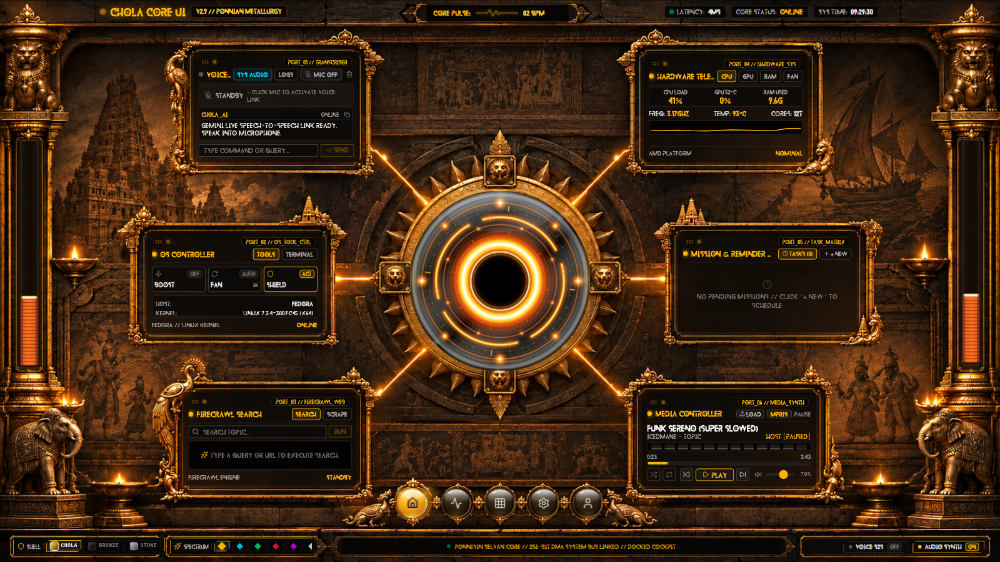

# Aether-Core — Autonomous AI Companion & Tactical OS Interface



Aether-Core is an autonomous desktop AI companion featuring a cyberpunk reactor HUD, real-time voice synthesis, multi-step agentic planning and execution, multimodal screen awareness, system diagnostics, and persistent long-term memory.

---

## ⚡ Key Features

- **Gold Metallurgy Reactor HUD**: Cybernetic real-time dashboard built with React, Tailwind CSS, Lucide icons, and Framer Motion.
- **Voice S2S Link**: Bidirectional Gemini Live Speech-to-Speech audio streaming and local STT/TTS pipeline.
- **Autonomous OS Control**: Live execution of system tasks, app launching, hardware telemetry, process monitoring, and desktop management.
- **Tactical Action Matrix**: Multi-step agentic planner and executor with sandboxed tools and fallback logic.
- **Firecrawl Web Intelligence**: Live web search, content scraping, and deep research extraction.
- **Media & Telemetry**: Integrated media playback, CPU/GPU/RAM metrics, and acoustic diagnostics.

---

## Architecture

```text
Aether-Core React Reactor HUD
  ↕ WebSocket (/ws/live) & REST API
Node.js / Express Bridge (frontend/server.ts)
  ↕ Python Subprocess Dispatcher
Aether Agentic Engine (backend/agent_engine.py)
  ├─ Autonomous Agent Pipeline (backend/agent/)
  │    ├─ Planner (multi-step goal decomposition)
  │    ├─ Executor (recovery, re-planning, sandboxed code)
  │    └─ TaskQueue (asynchronous job scheduling)
  ├─ Tactical Action Modules (backend/actions/)
  │    ├─ System & App control (open_app, cmd_control, computer_settings, desktop)
  │    ├─ Web & Browser automation (web_search, browser_control, form_filler)
  │    ├─ Media & Communications (media, send_message, youtube_video, weather)
  │    └─ Developer Tools (code_helper, dev_agent, game_updater)
  ├─ Persistent Long-Term Memory (backend/memory/)
  │    └─ memory_manager.py (identity, preferences, projects, relationships)
  ├─ Multimodal Vision (backend/vision.py)
  │    └─ Screen capture, object detection, NVIDIA Llama-3.2 vision
  └─ Real-Time Voice Sessions (backend/gemini_live_session.py, stt_engine.py, tts_engine.py)
```

---

## Quick Start

### Prerequisites
- Node.js 20+, npm
- Python 3.11 or 3.12 with dependencies (`backend/requirements.txt`)

### 1. Install Dependencies
```bash
# Install frontend dependencies
npm --prefix frontend install

# Install Python backend dependencies
pip install -r backend/requirements.txt
```

### 2. Configure Environment & API Keys
Copy `.env.example` to `.env.local` and configure your API keys:
```bash
cp .env.example .env.local
```

You can also configure backend keys in `backend/config/api_keys.json` (see `backend/config/api_keys.json.example`):
```bash
cp backend/config/api_keys.json.example backend/config/api_keys.json
```

- `GEMINI_API_KEY`: For Gemini Live real-time bidirectional voice & multimodal intelligence.
- `NVIDIA_API_KEY`: For autonomous agent planning and vision processing.
- `OPENROUTER_API_KEY`: (Optional) Fallback for agent planner.

> **Note**: Never commit your `.env.local` or `backend/config/api_keys.json` to public repositories.

### 3. Start Aether-Core
```bash
npm run dev
```
Open `http://127.0.0.1:3008` to interact with Aether-Core via voice, text commands, reactor controls, or telemetry dashboards.

---

## Verification

```bash
# Verify frontend types and production build
npm run lint
npm run build

# Verify backend agent engine
python3 backend/agent_engine.py health
python3 backend/agent_engine.py shell date
python3 backend/agent_engine.py memory_graph
python3 backend/agent_engine.py search "Quantum AI"
```
